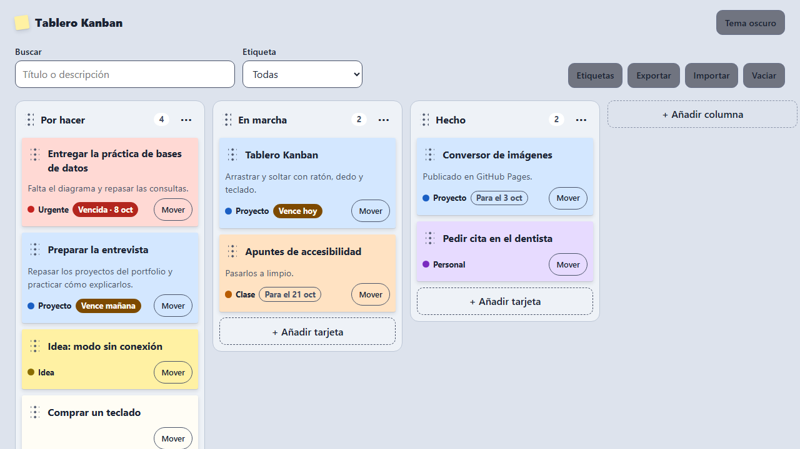

# Tablero Kanban

Un tablero Kanban con columnas y tarjetas que se mueven **arrastrando con el ratón, con el dedo o con el teclado**. Todo se guarda en el navegador: no hay servidor ni cuentas de usuario.

**Demo:** https://danimartin03.github.io/tablero-kanban



## Qué hace

- **Columnas** por defecto (Por hacer, En marcha, Hecho) que se pueden añadir, renombrar, mover y borrar.
- **Tarjetas** con título, descripción, etiqueta de color y fecha límite opcional. Avisa cuando una tarjeta está vencida o vence hoy o mañana.
- Cada tarjeta es un pósit del color de su etiqueta, y a cada color se le puede poner un nombre (Urgente, Casa, Proyecto…).
- **Arrastrar y soltar** tarjetas y columnas, con ratón y en el móvil.
- **Teclado:** con el foco en una tarjeta, `Alt` + flechas la mueve. También hay un botón "Mover" en cada tarjeta.
- **Buscador** por título y descripción, y **filtro** por etiqueta.
- Guardado automático en `localStorage`, y **exportar e importar** el tablero en JSON.
- Animación suave al mover, que se desactiva si el sistema pide reducir el movimiento.
- Tema claro y oscuro.

## Cómo funciona el arrastre

Uso **Pointer Events**, que valen igual para ratón, dedo y lápiz, así que hay un solo código para ordenador y móvil:

1. Al pulsar en el asa (los puntitos), dejo un **hueco** en el sitio de la tarjeta y la pongo a flotar con `position: fixed` para que siga al puntero.
2. Mientras se mueve, pregunto qué hay debajo del puntero con `document.elementFromPoint` y cambio el hueco de sitio.
3. Al soltar, cuento en qué posición ha quedado el hueco, cambio los datos y repinto.

En el móvil se arrastra solo desde el asa, que lleva `touch-action: none`. Así el resto de la tarjeta sigue sirviendo para hacer scroll con el dedo.

## Cómo funciona la animación

Al repintar, los elementos se crean de nuevo, así que no puedo animarlos con una transición normal. Lo que hago es:

1. Apuntar dónde está cada tarjeta **antes** de repintar.
2. Repintar: todo aparece ya en su sitio nuevo.
3. Calcular cuánto se ha movido cada una.
4. Animarla desde el sitio viejo hasta el nuevo con `element.animate`.

## Qué he aprendido

<!-- TODO: repasar esta lista y dejarla con mis palabras -->

- A hacer arrastrar y soltar a mano con Pointer Events, y por qué la API nativa de drag and drop no sirve bien en móviles.
- A usar `setPointerCapture`, `elementFromPoint` y `touch-action` para que el arrastre funcione con el dedo.
- Que lo que se hace con el ratón tiene que poder hacerse también con el teclado, y a anunciar cada movimiento con una zona `aria-live`.
- A animar elementos que cambian de sitio al repintar (apuntar la posición antes y después).
- A separar los datos del tablero (`tablero.js`) de lo que se ve en pantalla (`app.js`), y el arrastre (`arrastrar.js`) de los dos.
- A usar un solo listener para todo el tablero en vez de uno por botón (delegación de eventos).
- A no fiarme de los datos que vienen de fuera: valido entero un JSON importado y lo que hay en `localStorage`.

## Tecnologías

- HTML, CSS y JavaScript sin frameworks, sin librerías y sin proceso de compilación.
- Pointer Events, Web Animations API y `localStorage`.

## Privacidad

Los datos no salen del navegador. La página no hace ninguna petición a otros servidores y no usa cookies. En `localStorage` guardo el tablero y el tema elegido.

## Cómo ejecutarlo en local

No hace falta instalar nada. Vale con descargar el repositorio y abrir `index.html` en el navegador.

Si prefieres un servidor local, con Python:

```bash
python -m http.server 5530
```

Y después abre http://localhost:5530.

## Estructura

```
index.html          El tablero y las ventanas
css/estilos.css     Estilos (móvil primero, tema claro y oscuro)
js/tablero.js       Cambios sobre los datos: añadir, mover, borrar (no toca la página)
js/datos.js         Guardar, leer, validar, exportar e importar
js/arrastrar.js     Arrastrar y soltar con Pointer Events
js/app.js           Pintar el tablero, ventanas, teclado, buscador y filtro
```

## Límites que conozco

- Un solo tablero, guardado en un solo navegador: no se sincroniza entre dispositivos. Para pasarlo hay que exportar e importar el JSON.
- Importar sustituye el tablero que hay (pide confirmación antes).
- Con la búsqueda o el filtro puestos se puede pasar una tarjeta a otra columna, pero no cambiar su orden.
- Una sola etiqueta por tarjeta.
- Hasta 8 columnas y 200 tarjetas.
- Las columnas se arrastran con ratón o dedo; con el teclado se mueven desde sus opciones.

## Mejoras que haría

- Varios tableros.
- Deshacer el último movimiento o el último borrado.
- Varias etiquetas por tarjeta y listas de tareas dentro de una tarjeta.
- Límite de tarjetas por columna (lo que en Kanban se llama límite de trabajo en curso).
- Pruebas automáticas para `tablero.js`.

## Licencia

[MIT](LICENSE) © Daniel Martín Pérez
